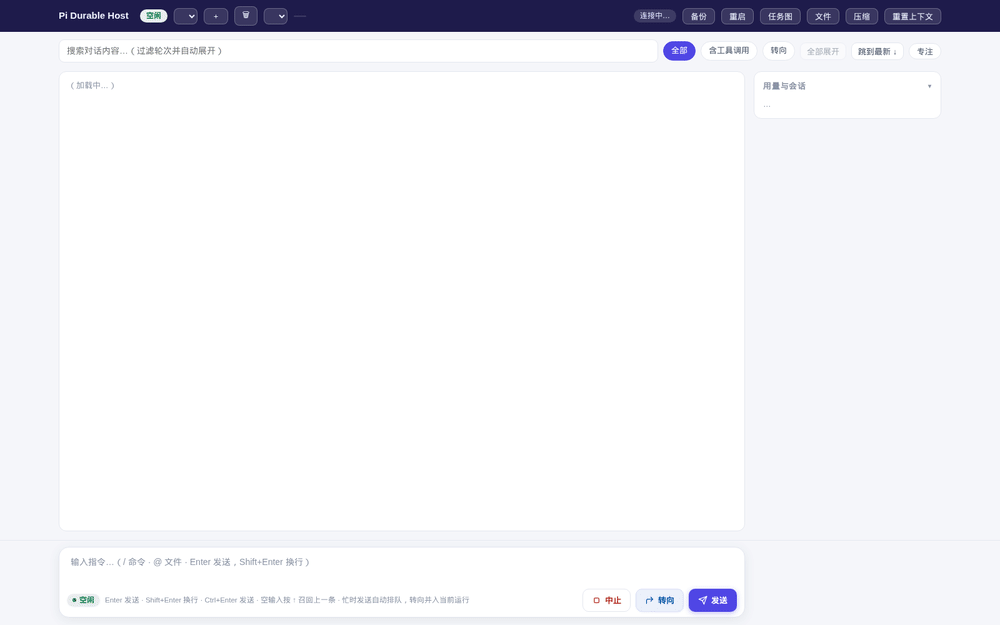

[中文](README.md) | **English**

# Pi Durable Host

A local host for [`@earendil-works/pi-durable`](https://github.com/earendil-works/pi/tree/main/packages/durable) (experimental; API subject to change): persistent agent sessions on SQLite (WAL), with **Web UI / CLI / REST API**. Crash-recoverable, hot-restart after code changes with zero data loss.

> For implementation details (layout, key mechanisms, design principles), see [docs/ARCHITECTURE.md](docs/ARCHITECTURE.md).

## Quick Start

```bash
npm install                       # installs pi-durable / pi-ai / chord
node host.js serve                # resident daemon (default http://127.0.0.1:7600)
node host.js ask "list this directory"   # or ask via CLI
```

Open <http://localhost:7600/> for the full UI. Runtime data lives in `data/` (gitignored).
Model config is **reused directly from your local pi CLI's** `~/.pi/agent/` — no re-configuration needed.



## Features

- **Persistent sessions**: SQLite (WAL) storage; after a crash, `resume()` continues unfinished runs (including in-flight responses)
- **Multiple sessions**: named sessions ↔ conversation mapping; switch anytime from UI or CLI
- **Models**: fully reuses pi config (custom relays + credentials); switch providers/models instantly in the UI
- **Image input** (pi-durable 1.2.0): the `read` tool returns images (jpg/png/gif/webp/bmp) as image blocks; Photon preprocessing (EXIF orientation, resize to model limits, lazy worker thread); `PI_DURABLE_IMAGES=0` disables
- **codemode** (pi-durable 1.2.0, opt-in): with `PI_DURABLE_CODEMODE=1` the agent can run JS scripts in a QuickJS sandbox that call tools as nested calls; scripts replay deterministically across restarts
- **Fork & retry**: fork a new session from any past question, rephrase and re-ask — the original session is untouched
- **Context debugging**: inspect exactly what the model saw at any entry
- **Dangerous-command approval**: guard interception + pending list + one-click approval
- **Judge checkups**: Jev-like typed judgments on the control plane — every run gets an automatic checkup (tool errors / empty answers / repeat failures) + full audit log; flagged runs show a badge suggesting fork-and-retry
- **Observability**: live task graph, tool timings, usage (tokens & cost per model)
- **Ops**: `VACUUM INTO` online backup, hot restart, log rotation, gzip for large responses

## Configuration

### Model backend (reuses pi config as-is)

The host keeps no model config of its own — it reads pi CLI's `~/.pi/agent/` directly, so the same code runs across machines unmodified:

| File | Purpose |
|---|---|
| `~/.pi/agent/models.json` | custom providers (relays / self-hosted endpoints): `baseUrl` + `api` + model catalog; `apiKey` supports `$VAR` env references (keys never on disk) |
| `~/.pi/agent/auth.json` | API-key credentials stored by pi `/login` |
| `~/.pi/agent/models-store.json` | pi's model-catalog cache (`pi update --models`) |
| `~/.pi/agent/settings.json` | `defaultProvider` / `defaultModel` |

Selection order: explicit `PI_DURABLE_PROVIDER=<id>` → `settings.json` `defaultProvider` → custom providers in `models.json` → credential providers in `auth.json`.
`PI_DURABLE_MODEL` overrides the default model; `PI_DURABLE_KEY_<PROVIDER_ID>` overrides credentials (takes precedence over auth.json); `PI_DURABLE_PI_DIR` overrides the pi agent directory.

Example custom relay (`~/.pi/agent/models.json`):

```json
{
  "providers": {
    "my-relay": {
      "baseUrl": "http://your-relay-host:3000/api",
      "apiKey": "$MY_RELAY_TOKEN",
      "api": "anthropic-messages",
      "models": [
        { "id": "your-model", "name": "Your Model", "reasoning": true,
          "input": ["text"], "contextWindow": 200000, "maxTokens": 65536 }
      ]
    }
  }
}
```

> If a relay doesn't publish pricing, the model catalog `cost` is 0 — the UI usage panel shows tokens but no money. No fabricated data.

### Environment variables

| Variable | Description |
|---|---|
| `PI_DURABLE_TOKEN` | daemon API auth token (**strongly recommended** when binding to a non-loopback address; protects UI / `/api/*` / `/files/*`) |
| `PI_DURABLE_HOST` | default serve listen address (default `127.0.0.1`) |
| `PI_DURABLE_DATA_DIR` | data directory (default `<repo>/data`; for tests / multi-instance) |
| `PI_DURABLE_PROVIDER` / `PI_DURABLE_MODEL` / `PI_DURABLE_KEY_*` / `PI_DURABLE_PI_DIR` | see above |
| `PI_DURABLE_JUDGE_URL` / `PI_DURABLE_JUDGE_KEY` / `PI_DURABLE_JUDGE_MODEL` | Jev/system-one compatible judge endpoint (falls back to the built-in heuristic rule judge when unset); endpoint failures degrade automatically — safety features are never disabled |
| `PI_DURABLE_JUDGE_ROUTING` | set to `auto` to enable busy-time judge routing (classify steer/queue when whenBusy is not explicit) |
| `PI_DURABLE_IMAGES` | `read` image support (default on); `0` disables Photon preprocessing — images still pass through as-is within model limits |
| `PI_DURABLE_CODEMODE` | codemode tool (default off); set `1` to enable (also via `features.codemode` in `data/host.json`) |

Requires Node >= 22.19 (the `node:sqlite` ExperimentalWarning can be ignored).

## Web UI (http://localhost:7600/)

- **Top bar**: session dropdown (switch/create/delete), model dropdown (applies immediately), backup, hot restart, task graph / files / compaction / reset
- **Transcript**: grouped by run; tool-call cards with paired call/result; markdown/tables/code blocks; live streaming
- **Fork (⑂)**: hover any user message → **⑂** button → confirm to fork a new session from that entry and switch to it
  (`Conversation.fork`: context and agent config copied up to that point, fresh provider identity). Rephrase and re-ask in the new session — that's "retry from here"; the original session is untouched. Button always visible on touch devices
- **Context debugging (⚿)**: hover a run header → **⚿** button → overlay showing exactly what the model saw at that question
  (`Conversation.context(at)`, same origin as `fork(at)`). Debug post-steer drift, compaction boundaries, context drift
- **Composer**: `/` command palette (host commands + custom commands from `~/.pi/agent/prompts/*.md`, argument semantics shared with pi CLI); `@` file completion; ↑ recalls the last message; drafts auto-saved; queue/steer choice while busy
- **Sidebar**: live runs, queued inbox, approvals panel (one-click approve/dismiss), usage (per model, cost when rates known), task graph, workspace files. Every panel **collapses via its title** (remembered in localStorage; collapsed approvals/inbox show a count badge)
- **Focus mode**: hide sidebar, narrow reading column
- SSE auto-reconnect (view recovers seamlessly after daemon hot restart)

## CLI

When the daemon is running, CLI commands forward to it automatically (single-writer lock is never contended); otherwise they open storage locally:

```bash
node host.js serve [port=7600] [--host h] [--takeover]  # resident daemon (recommended)
node host.js ask "..." [--fresh] [--session s]   # submit and wait; identical content reuses idempotently, --fresh forces a new submission
node host.js history [n] [--session s]           # last n transcript entries
node host.js context <entryId> [--session s]     # model context at that entry (same source as the UI ⚿)
node host.js wait [sec]                          # wait for unfinished runs; run once after boot/deploy
node host.js status                              # busy / retries / tools / compaction / inbox / agent / usage / live tasks
node host.js tasks                               # live task graph (ownership, waits, background flags)
node host.js sessions [new|switch|delete <name>] # named-session management
node host.js approve -- <command> [--list|--revoke n] # approve dangerous commands (live)
node host.js backup [file]                       # VACUUM INTO consistent snapshot
node host.js timing [n]                          # tool timing summary (n/avg/p50/p95/max)
node host.js restart                             # hot restart (successor resumes all runs)
node host.js config                              # reset stored cwd/model to this directory's current values
```

## HTTP API

Auth: once `PI_DURABLE_TOKEN` is set, every endpoint requires `Authorization: Bearer <token>` (SSE uses `?token=`).

| Endpoint | Description |
|---|---|
| `POST /api/ask` | `{ content, whenBusy?: "followUp"\|"steer"\|"reject", wait?, requestId?, session? }`; queue/steer while busy go here |
| `POST /api/abort` | abort the current run (background tasks unaffected) |
| `POST /api/compact` | `{ instructions? }` submit a compaction task |
| `POST /api/reset` | `{ note? }` reset context |
| `POST /api/config` | `{ cwd? / instructions? / model? }` (changes audited into `host.config` entries) |
| `POST /api/sessions` | `{ action: new\|switch\|delete, name }` |
| `POST /api/fork` | `{ entryId, name? }` fork a new session from a history entry and switch |
| `POST /api/wait-idle` | `{ timeoutMs?, session? }` wait for session idle (consistency before external automation); timeout → `{ idle: false }` |
| `POST /api/approve` / `/api/approve/revoke` / `/api/approvals/dismiss` | approvals management |
| `POST /api/backup` / `POST /api/restart` | online backup / hot restart |
| `GET /api/state[?light=1]` | full snapshot (light = metadata only, ~1.2KB); `GET /api/events` for SSE incremental updates |
| `GET /api/history` / `/api/entry?id=` / `/api/submission?id=` | transcript and submission records |
| `GET /api/context?entryId=n` | model context at that entry (message digest, dump-proof) |
| `GET /api/judge/log` / `GET /api/judge/checkups` | judge audit-log tail / run checkup records |
| `GET /api/status` / `/api/tasks` / `/api/usage` / `/api/models` / `/api/sessions` / `/api/approvals` / `/api/files` / `/api/commands` | read-only status endpoints |
| `GET /files/<path>` | workspace static files (path-traversal protected) |

## Core Semantics

### Named sessions

Each session name maps to an independent persistent conversation (`data/sessions.json`); `default` is the root conversation (id 1) — existing data works as-is. The daemon's UI/API/SSE all follow the "current session"; switching takes effect immediately. `ask --session <name>` targets a non-current session directly (delete only unmaps the name; conversation data is kept).

### Busy-time input (whenBusy)

When a message arrives while a run is generating (built-in pi-durable semantics; the host adds no options):

| whenBusy | Behavior | Typical use |
|---|---|---|
| `followUp` (default) | **Queue**: executed in order after the current run finishes | issuing several independent instructions in a row |
| `steer` | **Steer**: inserted at the current run's next turn | course correction ("don't use rm, use mv"), added constraints |
| `reject` | rejected while busy (HTTP 409) | automation requiring mutual exclusion |

Queued and steered messages both land in the transcript's `pi.inbox` (visible in the sidebar); steered ones also appear inside the current run group (tagged "steered").

### Dangerous-command approval (host-guard)

Bash commands matching dangerous patterns (`sudo`, `rm -r/-f`, `mkfs`, `dd of=/dev/*`, fork bombs, force pushes, disk wiping, …) are intercepted: the command goes to `data/approvals-pending.json` and the agent receives a prompt with an escape hatch. Approval channels:

- Web UI approvals panel: one-click "approve / dismiss" (pending count as a badge on the panel title)
- CLI: `node host.js approve -- <command>` (`--list` / `--revoke n`)
- Allowed-prefix wildcards: approving `git push origin*` whitelists every command starting with it

Approvals/revocations take effect live on a running daemon (the guard re-reads the file on every call); after approving, ask the agent to retry the original command.

### Judge checkups (Jev-like judgments)

The host control plane integrates System One (Jev-like, 2026-09; analysis report in-repo at `workspace/2026-09-jev-system-one-analysis.html`) style typed judgments with three primitives: Noul (truth probability) / Choice (option + distribution) / Score (rubric rating). Principles: atomic questions composed in code, confidence routing (high confidence auto / low confidence to humans), destructive operations always human-approved, and judgments never enter the conversation context (keeps fork/CTX semantics clean).

- **Run checkups**: every finished run is scored for tool errors / empty answers / repeat failures plus a judge health score; flagged runs show a ⚠ badge in the transcript (hover for details, hinting fork-and-retry via ⑂), with a sidebar checkup panel for history
- **Guard overlay**: allowed commands are audited too (`data/judge-log.jsonl`); with a real Jev endpoint configured, semantic judgments kick in
- **Busy-time routing** (opt-in): with `PI_DURABLE_JUDGE_ROUTING=auto`, when whenBusy is unspecified while busy → the judge classifies steer/queue; never auto-rejects
- **Provider**: built-in heuristic rule judge by default (no probability semantics; returns null outside its rules); set `PI_DURABLE_JUDGE_URL` to a Jev/jevlike compatible endpoint for semantic judgments, with automatic degradation on failure

### Single-writer model (important)

pi-durable storage has no cross-process lock: **one store can be opened by only one process at a time**. The host arbitrates via `data/host.lock`: while a live holder exists, other processes refuse to start; a dead holder is taken over automatically. **Recommended setup: run one `serve` daemon as the sole holder** — everyone else (humans, scripts, UI, CLI) goes through its HTTP API. While `serve` runs, CLI commands forward automatically instead of being rejected by the lock.

## Operations

### Backup

`node host.js backup` / `POST /api/backup`: consistent online snapshot, **pauses no runs**. Stored in `data/backups/` by default, newest 20 kept.

### Hot restart

`node host.js restart` / `POST /api/restart`: a successor process takes over and unfinished runs auto-`resume()`. The Web UI's SSE reconnects automatically. Typical use: upgrade after editing host code with zero data loss. Implementation notes and pitfalls: [ARCHITECTURE](docs/ARCHITECTURE.md).

### Session-failure self-exit (pi-durable 1.2.0 semantics)

Any storage error (disk full, IO failure, corruption) permanently closes the Session — every later call and wait rejects with `SessionFailed`, nothing retries. The daemon observes `harness.closed` and on failure logs, clears `serve.json`, and **exits non-zero** — no zombie "process alive but always wrong" daemon; a human/supervisor starts the successor. The UI live panel also surfaces `pi.live.compactionFailure` (kept until the next compaction succeeds — this failure used to be silent), and a nonzero bash exit is no longer an exception but an error result carrying `exit_code` (the model sees the code directly).

### Tool timing

`node host.js timing [n]`: summarizes `data/tool-timing.log` (per-tool n/avg/p50/p95/max) + last n entries.

## Known Limitations

- pi-durable is experimental; its API changes between versions (this repo pins dependency versions)
- On a Windows drive mounted into WSL (drvfs), SQLite WAL is slower than ext4; for heavy loads point `PI_DURABLE_DATA_DIR` at ext4
- The single-writer lock means two daemons cannot share one data directory (use different `PI_DURABLE_DATA_DIR` per instance)

## Deploy rhythm (after code changes)

```bash
node host.js restart      # hot restart: successor takes over, unfinished runs auto-resume
node host.js status       # confirm the new daemon is healthy
```
