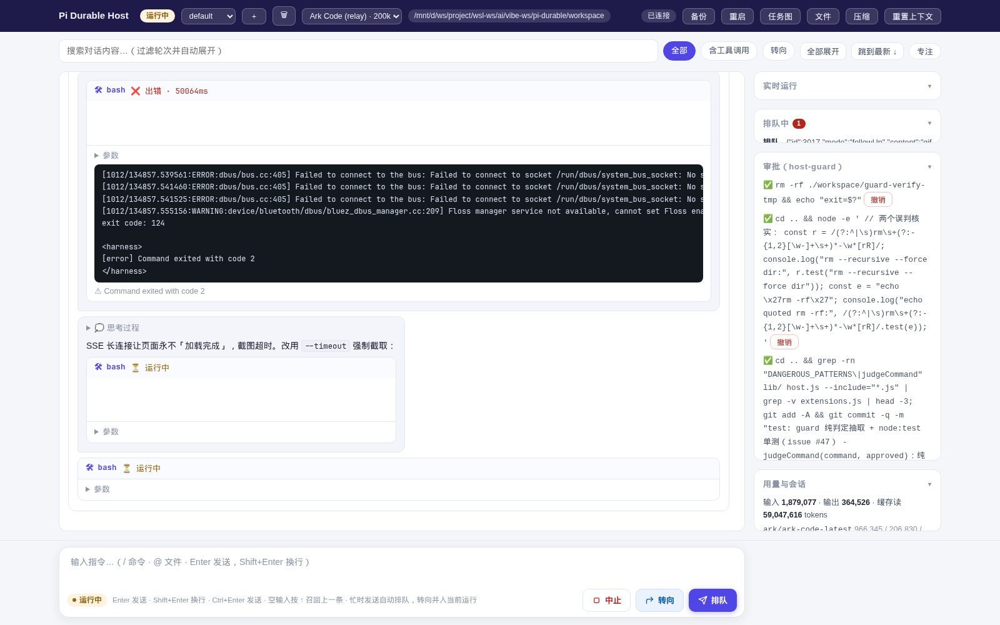

# Pi Durable Host

[`@earendil-works/pi-durable`](https://github.com/llnull/pi-durable)（实验性，API 随版本变动）的本地 host：把持久化 agent 会话跑在 SQLite（WAL）上，提供 **Web UI / CLI / REST API** 三种入口。进程崩溃可恢复，改代码后热重启零数据损失。

> 实现说明（目录结构、关键机制、设计原则）见 [docs/ARCHITECTURE.md](docs/ARCHITECTURE.md)。

## 快速开始

```bash
npm install                       # 安装 pi-durable / pi-ai / chord
node host.js serve                # 常驻 daemon（默认 http://127.0.0.1:7600）
node host.js ask "列出本目录结构"   # 或者直接 CLI 提问
```

浏览器打开 <http://localhost:7600/> 即得完整 UI。运行时数据都在 `data/`（已 gitignore）；
模型配置**直接复用本机 pi CLI 的** `~/.pi/agent/`，无需在 host 里再配一遍。



## 特性一览

- **持久会话**：SQLite（WAL）存储，崩溃后 `resume()` 接续未完成的 run（包括生成中的回答）
- **多会话**：命名会话 ↔ conversation 映射，UI/CLI 随时切换
- **模型**：完全复用 pi 配置（自定义中继 + 凭证），UI 内跨 provider 即时切换
- **分叉重试**：从任意提问分叉出新会话换说法重问，原会话不变
- **上下文调试**：查看任意条目处模型实际看到的 context
- **危险命令审批**：guard 拦截 + 待批清单 + 一键批准
- **可观测**：实时任务图、工具耗时、用量（按模型分 tokens 与金额）
- **运维**：`VACUUM INTO` 在线备份、热重启、日志轮转、大响应 gzip

## 配置

### 模型后端（完全复用 pi 配置）

host 不维护自己的模型配置——直接读 pi CLI 的 `~/.pi/agent/`，各机器自行配置，同一份代码跨机器无需修改：

| 文件 | 作用 |
|---|---|
| `~/.pi/agent/models.json` | 自定义 provider（中继/自建端点）：`baseUrl` + `api` + 模型目录；`apiKey` 支持 `$VAR` 环境引用（密钥不落盘） |
| `~/.pi/agent/auth.json` | pi `/login` 存储的 api-key 凭证 |
| `~/.pi/agent/models-store.json` | pi 维护的模型目录缓存（`pi update --models`） |
| `~/.pi/agent/settings.json` | `defaultProvider` / `defaultModel` |

选型顺序：`PI_DURABLE_PROVIDER=<id>` 显式指定 → `settings.json` 的 `defaultProvider` → `models.json` 自定义 provider → `auth.json` 凭证 provider。
`PI_DURABLE_MODEL` 覆盖默认模型；`PI_DURABLE_KEY_<PROVIDER_ID>` 覆盖凭证（优先于 auth.json）；`PI_DURABLE_PI_DIR` 覆盖 pi agent 目录。

自定义中继示例（`~/.pi/agent/models.json`）：

```json
{
  "providers": {
    "my-relay": {
      "baseUrl": "http://your-relay-host:3000/api",
      "apiKey": "$MY_RELAY_TOKEN",
      "api": "anthropic-messages",
      "models": [
        { "id": "your-model", "name": "Your Model", "reasoning": true,
          "input": ["text"], "contextWindow": 200000, "maxTokens": 65536 }
      ]
    }
  }
}
```

> 中继不公布价格时模型目录 `cost` 为 0，UI 用量面板显示 tokens 但不显示金额——不编造数据。

### 环境变量

| 变量 | 说明 |
|---|---|
| `PI_DURABLE_TOKEN` | daemon API 鉴权令牌（绑定非回环地址时**强烈建议**；UI / `/api/*` / `/files/*` 全受保护） |
| `PI_DURABLE_HOST` | serve 默认监听地址（默认 `127.0.0.1`） |
| `PI_DURABLE_DATA_DIR` | 数据目录（默认 `<repo>/data`；测试/多实例用） |
| `PI_DURABLE_PROVIDER` / `PI_DURABLE_MODEL` / `PI_DURABLE_KEY_*` / `PI_DURABLE_PI_DIR` | 见上 |

依赖：Node >= 22.19（`node:sqlite` 的 ExperimentalWarning 可忽略）。

## Web UI（http://localhost:7600/）

- **顶栏**：会话下拉（切换/新建/删除）、模型下拉（即改即生效）、备份、热重启、任务图/文件/压缩/重置入口
- **对话流**：按 run 分组；工具调用卡片 call/result 配对渲染；markdown/表格/代码块；流式生成实时显示
- **分叉（⑂）**：悬停任意一条用户提问 → 气泡旁 **⑂** 按钮 → 确认后从该条目分叉出新会话并切换
  （`Conversation.fork`：上下文与 agent 配置复制到该处、provider 身份全新）。新会话里换个说法重问即「从此重试」，
  原会话不变。触屏设备按钮常显
- **上下文调试（⚿）**：悬停 run 头部 → **⚿** 按钮 → 弹层显示该提问处模型实际看到的 context
  （`Conversation.context(at)`，与 `fork(at)` 起点同源）。调试 steer 之后、压缩边界、上下文漂移
- **composer**：`/` 命令面板（host 命令 + `~/.pi/agent/prompts/*.md` 自定义命令，参数语义与 pi CLI 同源）；
  `@` 文件补全；↑ 召回上一条；草稿自动保存；忙时「排队/转向」选择
- **侧栏**：实时运行、排队 inbox、审批面板（待批一键批准/撤销）、用量（按模型分行 + 费率可得时显示金额）、
  任务图、工作区文件。每个面板**点标题折叠/展开**（localStorage 记忆；折叠的审批/排队面板显示计数徽标）
- **专注模式**：收起侧栏、收窄为阅读列宽
- SSE 断线自动重连（daemon 热重启后视图无缝恢复）

## CLI

daemon 运行时自动转发到 daemon（单写者锁不冲突）；未运行时本地直连存储：

```bash
node host.js serve [端口=7600] [--host h] [--takeover]  # 常驻 daemon（推荐姿势）
node host.js ask "..." [--fresh] [--session s]   # 提交并等 run 结束；同内容幂等复用，--fresh 强制新提交
node host.js history [n] [--session s]           # 最近 n 条 transcript
node host.js context <entryId> [--session s]     # 该条目处的模型上下文摘要（与 UI ⚿ 同源）
node host.js wait [秒]                           # 等未完成 run 走完；开机/部署后先跑一次
node host.js status                              # busy / 生成重试 / 工具 / 压缩 / inbox / agent / 用量 / 活任务
node host.js tasks                               # 实时任务图（所有权、等待关系、后台标记）
node host.js sessions [new|switch|delete <name>] # 命名会话管理
node host.js approve -- <命令> [--list|--revoke n] # 批准危险命令（实时生效）
node host.js backup [文件]                       # VACUUM INTO 一致性快照
node host.js timing [n]                          # 工具耗时汇总（n/avg/p50/p95/max）
node host.js restart                             # 热重启（后继进程 resume 所有 run）
node host.js config                              # 重置存储的 cwd/model 为本目录当前值
```

## HTTP API

鉴权：设置 `PI_DURABLE_TOKEN` 后所有端点需 `Authorization: Bearer <token>`（SSE 用 `?token=`）。

| 端点 | 说明 |
|---|---|
| `POST /api/ask` | `{ content, whenBusy?: "followUp"\|"steer"\|"reject", wait?, requestId?, session? }`；忙时排队/转向都走这里 |
| `POST /api/abort` | 中止当前运行（后台任务不受影响） |
| `POST /api/compact` | `{ instructions? }` 提交压缩任务 |
| `POST /api/reset` | `{ note? }` 重置上下文 |
| `POST /api/config` | `{ cwd? / instructions? / model? }`（变更自动写入 `host.config` 审计条目） |
| `POST /api/sessions` | `{ action: new\|switch\|delete, name }` |
| `POST /api/fork` | `{ entryId, name? }` 从历史条目分叉新会话并切换 |
| `POST /api/wait-idle` | `{ timeoutMs?, session? }` 等会话空闲（外部自动化动作前的一致性保证）；超时 `{ idle: false }` |
| `POST /api/approve` / `/api/approve/revoke` / `/api/approvals/dismiss` | 审批管理 |
| `POST /api/backup` / `POST /api/restart` | 在线备份 / 热重启 |
| `GET /api/state[?light=1]` | 全量快照（light 仅元数据，1.2KB 级）；`GET /api/events` SSE 增量推送 |
| `GET /api/history` / `/api/entry?id=` / `/api/submission?id=` | transcript 与提交记录 |
| `GET /api/context?entryId=n` | 该条目处的模型上下文（消息摘要，防倾倒） |
| `GET /api/status` / `/api/tasks` / `/api/usage` / `/api/models` / `/api/sessions` / `/api/approvals` / `/api/files` / `/api/commands` | 状态类只读端点 |
| `GET /files/<path>` | 工作区静态文件（路径穿越防护） |

## 核心语义

### 命名会话

每个会话名对应一个独立持久 conversation（`data/sessions.json`）；`default` 即 root conversation（id 1），
历史数据无缝兼容。daemon 的 UI/API/SSE 全部跟随「当前会话」，切换即时生效；
`ask --session <name>` 可直接对非当前会话提问（delete 只解除映射，conversation 数据保留）。

### 忙时输入（whenBusy）

会话生成中收到新消息时（pi-durable 内建语义，host 未加配置项）：

| whenBusy | 行为 | 典型用途 |
|---|---|---|
| `followUp`（默认） | **排队**：生成结束后依次执行 | 连续下达多条独立指令 |
| `steer` | **转向**：插入当前运行的下一轮 | 纠偏（"别用 rm，用 mv"）、补充约束 |
| `reject` | 忙时直接拒绝（HTTP 409） | 自动化要求互斥 |

排队与转向都进 transcript 的 `pi.inbox`（侧栏可见）；转向消息还出现在当前 run 分组内（标「转向」）。

### 危险命令审批（host-guard）

bash 命令命中危险模式（`sudo`、`rm -r/-f`、`mkfs`、`dd of=/dev/*`、fork 炸弹、强制推送、磁盘抹除等）时被拦截：
命令进 `data/approvals-pending.json` 待批清单，agent 收到含 escape hatch 的提示。批准途径：

- Web UI 审批面板一键「批准 / 忽略」（待批数以徽标显示在面板标题）
- CLI：`node host.js approve -- <命令>`（`--list` / `--revoke n`）
- 允许前缀通配：批准 `git push origin*` 放行所有以它开头的命令

批准/撤销对运行中的 daemon 实时生效（guard 每次调用重读文件）；批准后让 agent 重试原命令即可。

### 单写者模型（重要）

pi-durable 存储无跨进程锁：**一个存储同一时刻只能被一个进程打开**。host 用 `data/host.lock` 互斥：
持有者存活时其他进程拒绝启动，已死时自动接管。**推荐姿势：跑一个 `serve` 常驻进程作为唯一持有者**，
其余一切（人、脚本、UI、CLI）走它的 HTTP 接口——serve 运行期间 CLI 命令自动转发，不再被锁拒绝。

## 运维

### 备份

`node host.js backup` / `POST /api/backup`：在线一致性快照，**不暂停任何 run**。默认存 `data/backups/`，保留最新 20 份。

### 热重启

`node host.js restart` / `POST /api/restart`：后继进程接管，未完成 run 自动 `resume()`。Web UI 的 SSE 自动重连。
典型用途：改完 host 代码后零数据损失升级。实现细节与踩坑记录见 [ARCHITECTURE](docs/ARCHITECTURE.md)。

### 工具耗时

`node host.js timing [n]`：`data/tool-timing.log` 汇总（每工具 n/avg/p50/p95/max）+ 最近 n 条。

## 已知限制

- pi-durable 是实验性库，API 随版本变动（本仓库锁定依赖版本）
- 仓库放 Windows 盘挂进 WSL（drvfs）时 SQLite WAL 性能低于 ext4；重负载建议 `PI_DURABLE_DATA_DIR` 指向 ext4
- 单写者锁意味着同一数据目录不能同时跑两个 daemon（多实例用不同 `PI_DURABLE_DATA_DIR`）

## 部署节奏（改代码后）

```bash
node host.js restart      # 热重启：后继进程接管，未完成 run 自动 resume
node host.js status       # 确认新 daemon 状态
```
